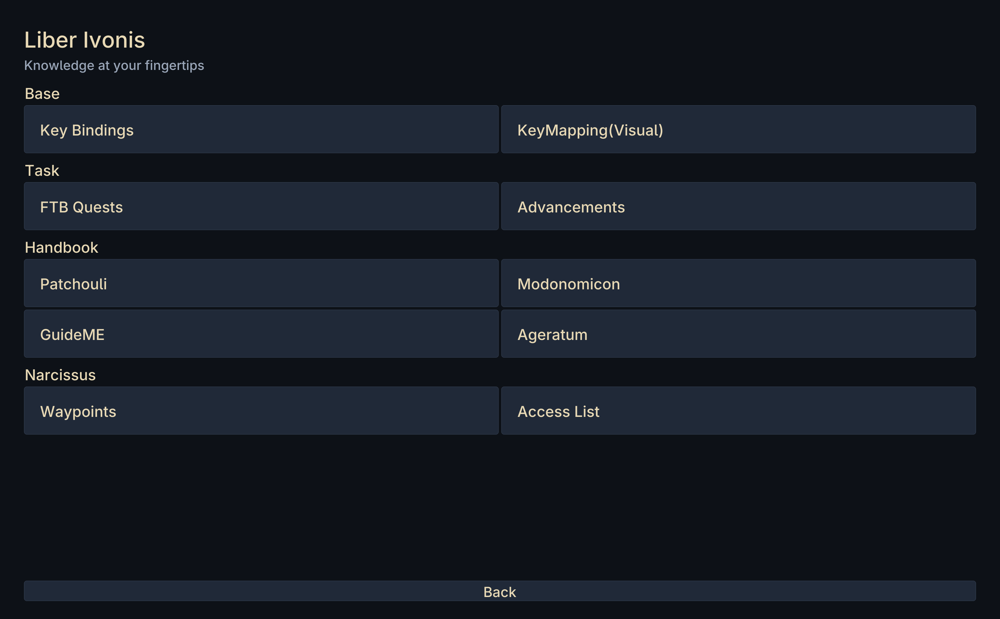

<div align="center">

# Liber Ivonis 伊波恩之书

*Minecraft Modpack Screen Hub*

</div>



## Introduction

In a modpack with many mods, we need to bind many keys only to open a certain screen; Liber Ivonis is a mod that provides a screen hub to collect those screens.

[ModernUI](https://www.curseforge.com/minecraft/mc-mods/modern-ui) is required to run this mod.

## Feature

- A Screen Hub to collect screens 
- Open with the Liber Ivonis item, key, or FTB Library button
- Integration of FTBQuests, Patchouli, Modonomicon, GuideME & Ageratum
- Define nested layouts, entries, and theme colours in one JSON file
- Local language overrides for layout translation keys
- Back and Escape return to the screen that opened the Hub

## Configuration

On first launch, Liber Ivonis creates:

```text
config/
└── liber_ivonis/
    ├── hub.json
    ├── README.md
    └── lang/
        ├── en_us.json
        ├── zh_cn.json
        ├── zh_hk.json
        └── zh_tw.json
```

`hub.json` defines the Hub with nested ModernUI-style containers and widgets.
`column`, `row`, `scroll`, `grid`, `text`, `entry`, `button`, and `spacer`
nodes can be freely nested. Entries use explicit fields instead of a packed
string list:

```json
{
  "schemaVersion": 1,
  "theme": {
    "background": "#FF0D0F15",
    "surface": "#FF171A23",
    "surfaceAlt": "#FF2E3547",
    "accent": "#FFF2F5F9",
    "muted": "#FFAEB8C6",
    "outline": "#FF7FD9F5",
    "disabledOutline": "#FF2B3244"
  },
  "layout": {
    "type": "column",
    "padding": [24, 22, 24, 18],
    "background": "background",
    "children": [
      {"type": "text", "text": "screen.liber_ivonis.hub", "size": 22},
      {
        "type": "grid",
        "columns": 2,
        "gap": 8,
        "children": [
          {"type": "entry", "builtin": "ftbquests"},
          {"type": "entry", "item": "ageratum:guidebook", "title": "my_pack.guidebook"},
          {
            "type": "entry",
            "screen": "com.example.ScreenFactory",
            "method": "create",
            "title": "my_pack.example_screen"
          }
        ]
      },
      {
        "type": "button",
        "action": "close",
        "text": "screen.liber_ivonis.back",
        "width": "match_parent"
      }
    ]
  }
}
```

Layout and language JSON files are re-read whenever the Hub opens. If
`hub.json` is invalid, the bundled layout is used and the error is logged.
The generated `config/liber_ivonis/README.md` documents every supported node,
dimension, colour and entry field.
The in-game ModernUI settings page shows layout validation status and theme
preview, and provides buttons to open the config folder, reload the file, or
preview the resulting Hub. Preview mode keeps world-dependent entries visible
but disabled when no player/world is loaded.

Configured translation keys are resolved in this order:

1. The selected language in `config/liber_ivonis/lang`.
2. English in `config/liber_ivonis/lang`.
3. Minecraft's loaded language resources.
4. The node's `fallback`.

ModernUI 3.13 does not expose a public XML layout inflater. Liber Ivonis
therefore uses a JSON description that is translated into native ModernUI
views rather than injecting a separate rendering implementation.

The Hub layout and its seven theme colours live entirely in `hub.json`. The
only remaining TOML file is the server-side gameplay setting:

```toml
[gameplay]
giveBookOnStart = true
```

Older `liber_ivonis-client.toml` files are no longer read or generated. Custom
entries from that file must be moved into `hub.json`.
